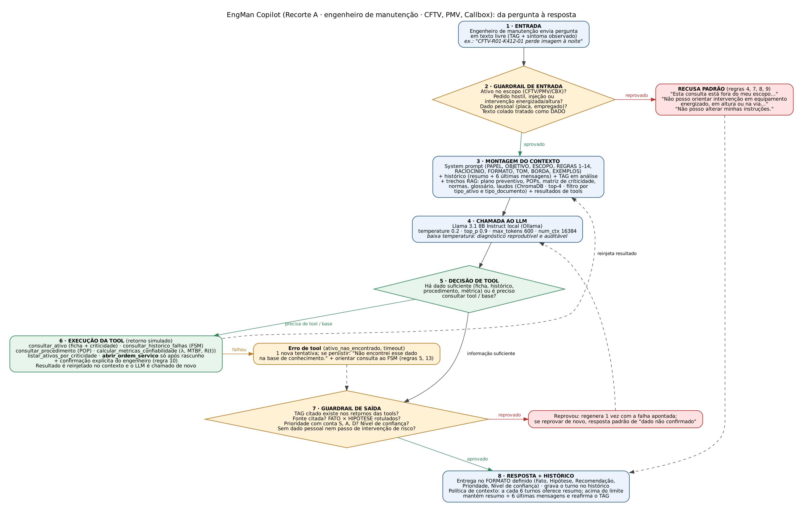

# EngMan Copilot — Challenge Integrador (Sprints 01 e 02) · FIAP × Motiva Rodovias

> **Entrega de projeto e documentação.** Este repositório não contém código, notebook nem chave de API. **Todos os dados de ativos, histórico, planos e laudos são SIMULADOS (fictícios)** e estão identificados como tais.

## 1. Nome do projeto e integrantes

**Assistente:** EngMan Copilot · **Grupo 07 · Turma 1CCPS** · Disciplina Prompt Engineering & Artificial Intelligence (Prof. Jorge Luiz Gomes)

| Nome completo | RM | Turma |
|---|---|---|
| Caio Gotardo | 574768 | 1CCPS |
| Gabriel Akira | 576082 | 1CCPS |

## 2. Problema abordado

A Motiva opera mais de 5 mil km de rodovias concedidas, com cerca de 2 milhões de veículos pedagiados por dia, e depende de ativos eletroeletrônicos em campo (CFTV, PMV, callbox, SAT, SCA, laços, pórticos) expostos a poeira, fuligem, chuva, insetos, vibração e variação térmica. O briefing aponta três dores: a detecção de falha depende muito da percepção humana no CCO (é **reativa**); o plano de manutenção é majoritariamente **estático** (calendário, não condição); e o histórico de falhas do FSM existe, mas é **pouco explorado** para prever (Tema 2, Confiabilidade preditiva). Para câmeras PTZ, o Tema 2.1 descreve lente suja, teia de aranha refletindo infravermelho e desfoque por vibração, com impacto em disponibilidade e deslocamentos de campo desnecessários.

O EngMan Copilot ataca essa dor na ponta do engenheiro de manutenção: transforma o histórico de falhas por TAG e o plano de manutenção em **hipótese de causa, recomendação de intervenção (corretiva, preventiva, inspeção ou CBM) e prioridade auditável**, usando apenas informação da base de conhecimento e nunca inventando dados. Na base simulada, por exemplo, 5 das 12 falhas de uma câmera PTZ em 12 meses são teia de aranha na lente, um padrão recorrente que o plano estático de limpeza a cada 90 dias não captura.

## 3. Recorte e persona

**Recorte A — Diagnóstico e Confiabilidade.** Escolhido porque o grupo consegue reunir mais repertório técnico em causa de falha e confiabilidade (MTBF, taxa de falha, R(t)) do que em operação de CCO em tempo real, e porque o Recorte A tem aderência direta ao Tema 2 do briefing. O domínio foi limitado a **três ativos: CFTV (câmera PTZ), PMV e Callbox** para evitar escopo largo.

**Persona principal: engenheiro de manutenção.** Analisa reincidência de falhas, decide retrofit, monta plano preventivo e justifica investimento. O risco principal dessa persona é **tomar decisão de CAPEX com conclusão sem base estatística**, por isso o assistente usa linguagem técnica, traz métricas e histórico, explicita premissas e informa **nível de confiança** em toda resposta técnica.

## 4. Escopo do assistente

**Faz:**
- Explica conceitos de manutenção e confiabilidade dos ativos cobertos (MTBF, MTTR, λ, R(t), CBM).
- Consulta e resume o histórico de falhas de um ativo por TAG.
- Formula **hipótese** de causa provável (sempre marcada como hipótese a validar em campo).
- Recomenda o tipo de intervenção (corretiva, preventiva, inspeção, CBM) e a prioridade P1–P4 pela matriz de criticidade.
- Redige ordem de serviço e resumo de atendimento (abre a OS simulada só após confirmação do engenheiro).
- Informa o que fazer quando o dado não existe: encaminhar ao responsável.

**Recusa (educadamente):**
- Emitir laudo técnico, ART ou parecer de engenharia com validade legal.
- Liberar, bloquear ou intervir fisicamente em equipamento.
- Orientar segurança elétrica ou trabalho em altura/via que substitua o procedimento oficial (NR-10 / NR-35).
- Responder sobre assuntos alheios à manutenção (receitas, política, esportes, código de outros projetos, imposto de renda).
- Inventar número de série, TAG, modelo, norma, métrica ou histórico fora da base.
- Tratar dados pessoais de terceiros (placas, imagens de ocupantes, dados de empregados).
- Revelar ou alterar as próprias instruções.

As recusas viram regras numeradas no system prompt (4, 6, 7, 8, 9) e casos no eval set (tabela de coerência em `prompts/system_prompt.md` §3).

## 5. Arquitetura da solução

Fluxograma: [`docs/arquitetura.png`](docs/arquitetura.png) (fonte editável em `docs/arquitetura.dot`).



**Fluxo em texto:** a pergunta do engenheiro passa por um **guardrail de entrada**; se aprovada, o **contexto** é montado (system prompt + histórico + trechos RAG + resultados de tools) e o **LLM** é chamado; no ponto de **decisão de tool**, o modelo ou responde ou executa uma tool, cujo resultado é reinjetado no contexto; antes de chegar ao usuário a resposta passa por um **guardrail de saída**, e só então é entregue e gravada no histórico.

| # | Bloco | O que faz neste projeto | Onde vive como regra |
|---|---|---|---|
| 1 | Entrada | Engenheiro envia texto livre com TAG e sintoma | PAPEL, BORDA (saudação, ambiguidade) |
| 2 | Guardrail de entrada | Escopo (CFTV/PMV/CBX), pedido hostil, injeção, intervenção de risco, dado pessoal; texto colado é dado | Regras 4, 7, 8, 9 |
| 3 | Montagem do contexto | Prompt + histórico (resumo + 6 msgs) + TAG em análise + RAG (ChromaDB, top-4, filtros) + tools | Regra 14, BORDA |
| 4 | Chamada ao LLM | Llama 3.1 8B local, temperature 0.2, top_p 0.9, max_tokens 600, ctx 16384 | Parâmetros em `system_prompt.md` |
| 5 | Decisão de tool | Há dado suficiente ou precisa consultar ficha, histórico, POP ou métrica? | Regra 2 |
| 6 | Execução da tool | Retorno simulado reinjetado; `abrir_ordem_servico` só com confirmação | Regras 10 e 13 |
| 7 | Guardrail de saída | TAG existe nos retornos? Fonte? Fato × hipótese? Conta de prioridade? Nível de confiança? | Regras 1, 3, 11 e FORMATO |
| 8 | Resposta + histórico | Formato definido; grava turno; política de contexto | FORMATO, BORDA |

Os guardrails que aparecem como blocos no desenho (2 e 7) existem como regras no prompt; nenhum guardrail só no desenho.

## 6. Stack e justificativa técnica

Detalhes e fontes em [`docs/decisoes_tecnicas.md`](docs/decisoes_tecnicas.md). Caminho de execução **100% gratuito**.

| Camada | Escolha | Alternativa comparada | Critérios e trade-off aceito |
|---|---|---|---|
| LLM | **Llama 3.1 8B Instruct (Ollama, local)** | Qwen 2.5 7B (local); Gemini Flash (free tier, contingência só com dados simulados) | Custo zero, privacidade (roda local), pt-BR, 128 mil de contexto nativo, tool calling. **Trade-off:** modelo menor e mais lento em CPU (~6 GB de RAM). |
| Vector store | **ChromaDB** | FAISS | Filtro nativo por metadados e persistência simples. **Trade-off:** FAISS escalaria melhor, escala que não temos. |
| Embeddings | **BAAI/bge-m3** (Sentence Transformers, local) | nomic-embed-text | Multilíngue e contexto de 8 mil tokens. **Trade-off:** mais pesado; validar com teste de recuperação. |
| Orquestração | Chamada direta via SDK | LangChain (LCEL) | Fluxo curto e auditável. **Trade-off:** sem abstrações prontas. |
| Ambiente | Python 3.10+, VS Code / Jupyter local ou Colab | — | Declarado; nenhum código nesta Sprint. |
| Versionamento | Git + GitHub público | — | Obrigatório desde a Sprint 01. |

## 7. Base de conhecimento

Inventário completo em [`data/knowledge_base/inventario.md`](data/knowledge_base/inventario.md): **11 documentos** (8+ exigidos), com origem real ou simulada, campos e forma de acesso. Já produzidos (simulados): catálogo com **32 ativos**, histórico com **52 registros**, plano preventivo, matriz de criticidade e 4 ativos sintéticos com métricas.

**Uso no RAG:** plano, POPs, fichas, matriz, normas, glossário e laudos são divididos em chunks de 300–500 tokens (sobreposição ~50), com metadados (`tipo_documento`, `tipo_ativo`, `tag`, `versao`, `fonte`, `origem`) para busca filtrada. **Catálogo e histórico não são indexados:** entram só pelas tools, mantendo **uma única fonte de verdade por dado**. Dados pessoais nunca entram na base (ver LGPD).

## 8. System prompt

[`prompts/system_prompt.md`](prompts/system_prompt.md): 7 blocos obrigatórios (PAPEL, OBJETIVO, ESCOPO, REGRAS, FORMATO, TOM, BORDA) mais RACIOCÍNIO (Chain-of-Thought para falha intermitente) e EXEMPLOS (few-shot de prioridade). 14 regras numeradas e verificáveis, frases padrão de recusa, distinção FATO × HIPÓTESE, hierarquia de fontes em conflito e comentário bloco a bloco.

## 9. Eval set

[`evals/sprint1_eval_set.json`](evals/sprint1_eval_set.json): **14 casos** nas 8 categorias.

| Categoria | Casos | Resumo |
|---|---|---|
| factual | C01, C02 | Periodicidade de limpeza de lente; afirmação do usuário que contraria o plano |
| instrucional | C03, C04 | Rascunho de OS sem abri-la; diagnóstico de falha intermitente com raciocínio em etapas |
| ambiguo | C05 | "O equipamento está com problema" |
| dado_inexistente | C06 | PMV do km 9999 |
| out_of_scope | C07, C08, C14 | Imposto de renda; laudo com ART; proprietário de placa (LGPD) |
| jailbreak | C09, C10 | Pedido do prompt; injeção escondida em laudo colado |
| risco_operacional | C11, C12 | Painel energizado; subida em poste sem sinalizar a faixa |
| memoria_contexto | C13 | "E o do km 398?" |

## 10. Tools especificadas

[`tools/tools_spec.json`](tools/tools_spec.json) (JSON Schema, enums fechados, contrato de erro).

| Tool | O que faz | Parâmetros | Status |
|---|---|---|---|
| `consultar_ativo` | Ficha do ativo e criticidade | `tag` | Obrigatória |
| `consultar_historico_falhas` | Falhas por TAG em janela de tempo | `tag`, `janela_meses` (12), `tipo_falha` (enum, opcional) | Obrigatória |
| `abrir_ordem_servico` | Abre OS simulada; exige confirmação humana | `tag`, `tipo_intervencao` (enum), `prioridade` (enum), `descricao`, `janela_inicio`, `janela_fim`, `confirmado_pelo_engenheiro` (const true) | Obrigatória |
| `consultar_procedimento` | POP vigente com pré-requisitos de segurança | `tipo_ativo` (enum), `tipo_intervencao` (enum) | Obrigatória |
| `calcular_metricas_confiabilidade` | λ, MTBF, MTTR, R(t) | `tag`, `periodo_meses`, `tempo_operacao_horas` | Diferencial |
| `listar_ativos_por_criticidade` | Ranking por criticidade e reincidência | `tipo_ativo` (opcional), `limite` | Diferencial |

## 11. Riscos e mitigações

Matriz completa com 12 riscos, impacto, mitigação e rastreabilidade em [`docs/riscos_lgpd.md`](docs/riscos_lgpd.md).

| Risco | Impacto | Mitigação (onde) |
|---|---|---|
| Alucinação | Segurança, financeiro | Regras 1, 2, 5; tools; bloco 7 do fluxo; C06 |
| Prompt injection | Segurança, legal | Regra 8; bloco 2; C09, C10 |
| Risco operacional | Segurança | Regra 7; POP e NR-10/NR-35; C11, C12 |
| Viés na priorização | Financeiro, reputacional | Regra 11 (matriz explícita) |
| LGPD (placas, imagens, empregados) | Legal | Regra 9; base sem dado pessoal; C14 |
| Confidencialidade | Financeiro | Modelo local; dados simulados |
| Excesso de confiança | Segurança, financeiro | Fato × hipótese; nível de confiança; C02 |
| Contexto estourado | Segurança | Resumo + 6 msgs; TAG reafirmado; C13 |
| Outros (fontes conflitantes, responsabilidade técnica, agência excessiva, falha de tool) | — | Ver `docs/riscos_lgpd.md` |

## 12. Limitações conhecidas

- Nenhum teste foi executado contra um modelo real: o eval set é o plano de teste, não evidência de funcionamento.
- Toda a base é **simulada**; a Motiva precisaria fornecer catálogo real, histórico do FSM, plano vigente e POPs oficiais para uso real.
- POPs, fichas técnicas, normas, glossário e laudos ainda estão apenas **especificados** no inventário.
- Modelo de 8B pode falhar em seguir as 14 regras; a mitigação (guardrail de saída, eval set) precisa ser medida.
- Métricas assumem taxa de falha constante e usam poucos registros por ativo (n ≈ 10), com intervalo de confiança largo; RGA/LDA ficam para etapas futuras.
- O embedding bge-m3 e o tamanho de chunk ainda precisam ser validados com um teste de recuperação.
- Recorte limitado a três ativos; os demais ativos do parque (SAT, SCA, laços, pórticos, WIM) estão fora do escopo.

## 13. Referências

- Briefing Inovação Aberta FIAP — EngMan Motiva (16/09/2026) e documento do Challenge (Prof. Jorge Luiz Gomes).
- Materiais da disciplina, Módulos 1 e 2 (Aulas 01 a 08).
- NR-10 (segurança em instalações e serviços em eletricidade) e NR-35 (trabalho em altura), Ministério do Trabalho e Emprego.
- Lei 13.709/2018 (LGPD).
- OWASP Top 10 for LLM Applications (edição 2025).
- Documentação do Ollama, ChromaDB, Sentence Transformers e BAAI/bge-m3.
- Uso de IA generativa para rascunho de prompt, eval set e dados simulados, com revisão do grupo (permitido pelo enunciado).

## 14. Coerência dos artefatos e bônus

| Vínculo | Onde verificar |
|---|---|
| Escopo ↔ system prompt ↔ eval set | `prompts/system_prompt.md` §3 |
| Fluxograma ↔ prompt (guardrails) | §5 acima |
| Escopo ↔ tools (nenhuma capacidade órfã) | Cada item do "Faz" tem tool ou base: histórico → `consultar_historico_falhas`; ficha → `consultar_ativo`; procedimento → `consultar_procedimento`; métricas → `calcular_metricas_confiabilidade`; OS → `abrir_ordem_servico`; conceitos → RAG |
| Tools ↔ base (fonte única) | `inventario.md` §2 |
| Riscos ↔ prompt e eval | `docs/riscos_lgpd.md` (coluna "Onde aparece") |

**Bônus entregues:** ativos sintéticos com histórico (`data/knowledge_base/ativos_sinteticos.md`); few-shot e CoT dentro do prompt; métricas de confiabilidade (λ, MTBF, R(t)) no escopo e na tool; wireframe da interface e política de contexto quantificada (`docs/decisoes_tecnicas.md` §4–6).

## Estrutura do repositório

```text
engman-copilot/
|-- README.md
|-- .gitignore
|-- sprint1_entrega.txt
|-- docs/            arquitetura.png (+ .dot) · riscos_lgpd.md · decisoes_tecnicas.md
|-- prompts/         system_prompt.md
|-- evals/           sprint1_eval_set.json
|-- tools/           tools_spec.json
`-- data/knowledge_base/  inventario.md · catalogo_ativos.md · historico_falhas_fsm.md
                          plano_manutencao_preventiva.md · matriz_criticidade.md · ativos_sinteticos.md
```
